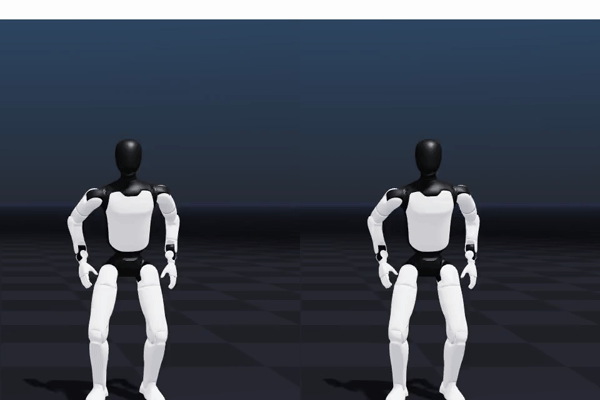

# A3 shoulder/wrist continuity — clip 19

Left: before. Right: after.

[Before: original SOMA vs A3 (MP4)](before.mp4) · [After: original SOMA vs A3 (MP4)](after.mp4)

These renders reproduce the single-clip experiment with the bundled upstream A3 asset and the proposed PR implementation. They are not a dataset-wide validation.
The GIF crops the robot half of each original video for a side-by-side preview;
the MP4 files retain the original SOMA/robot comparison. No raw motion data is included.

- Source: BONES-SEED SOMA Uniform `221129/reach_jump_R_004__A077.bvh`, 424 frames at 120 Hz.
- Videos: 107 frames at 30 fps; first output frame is t=0.
- Model: upstream `agibot-a3t3` URDF and its bundled SOMA calibration at `cbdb2b4`; Newton 1.3.0, Warp 1.16.0. No model or calibration changes.
- Implementation: `aaa746d` on `feat/joint-continuity`; reproducible with `docs/examples/compare_joint_continuity.py` and a licensed input BVH.
- Change: add a residual `2 * (q_current - q_previous_base_solution)` on both shoulders, elbows and wrists.
- Existing 24 IK iterations, static smooth filter, limits and contact/post-processing settings were retained.
- Fast arm lowering is smoother, with visible lag. This prior trades tracking accuracy for continuity; it is not a hard speed limit or a collision/dynamics guarantee.
- [Numerical measurements](metrics.json): in 0.90–1.05 seconds, maximum shoulder-yaw change falls from 17.4405 to 6.1529 degrees/frame; wrist-roll change from 12.4119 to 4.2657 degrees/frame. Both outputs contain 424 finite frames. These measurements use 120 Hz CSV coordinates, not the 30 fps videos.

## Credits

**Motion Data by [Bones Studio](https://bones.studio/).**
Dataset: [bones-studio/seed](https://huggingface.co/datasets/bones-studio/seed).
Use of the underlying dataset is subject to the [BONES-SEED Dataset License Agreement](https://bones.studio/info/seed-license).
SOMA model and renderer: [NVIDIA/soma-retargeter](https://github.com/NVIDIA/soma-retargeter).
Robot: Agibot A3, using the [asset bundled with NVIDIA/soma-retargeter](https://github.com/NVIDIA/soma-retargeter/tree/cbdb2b4/soma_retargeter/assets/robotics/agibot/a3).
The renders do not redistribute BVH/CSV motion files or model/mesh assets.
